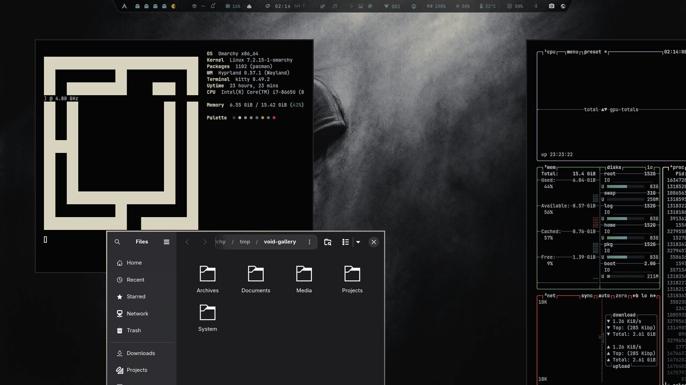
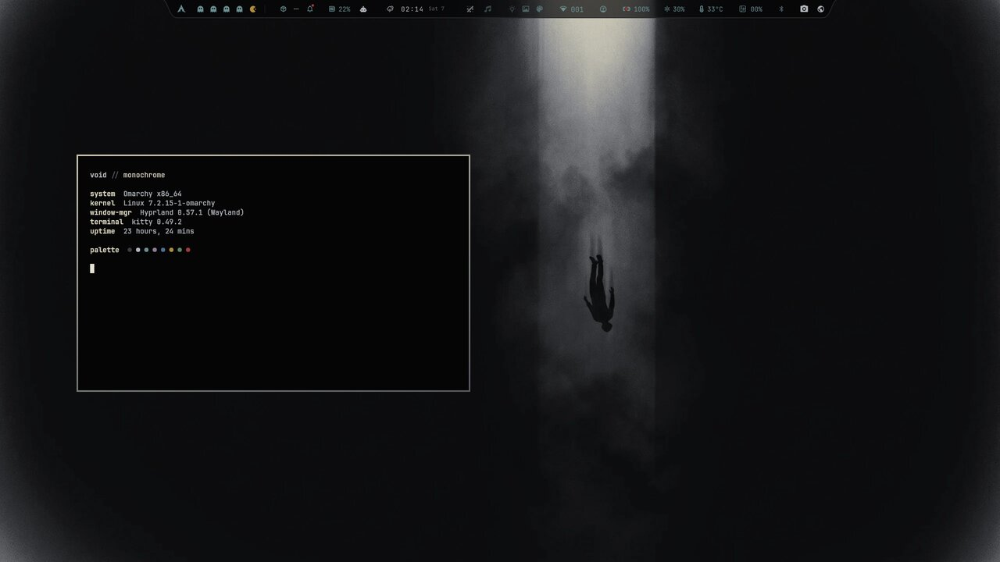
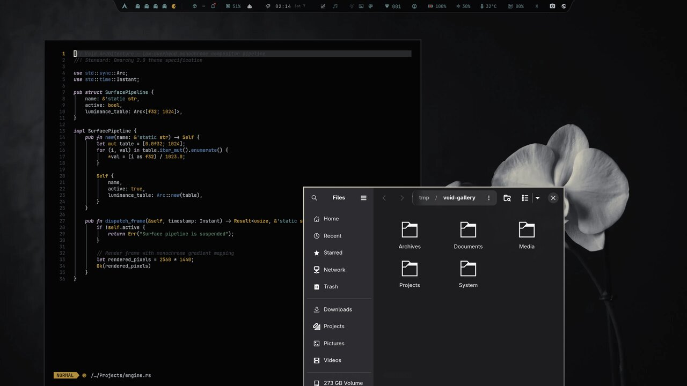

# Void

Near-monochrome, ultra-dark muted-sage theme for Omarchy.


## Design Identity

Void delivers a deep, distraction-free environment built around pitch-black `#050506` surfaces, subtle charcoal framing `#1c1e22`, subdued readable foreground text `#b4b8bd`, calm sage-green accents (`#5f8068` / `#7fa488`), and delicate pale cream highlight `#d8d3bf`:

- **Surface Depth Hierarchy:** Deep `#050506` surfaces paired with `#030304`, `#020202`, and `#0d0e10` tiers for cards, popups, and scrims.
- **Hyprland Borders:** Coordinated dual-stop gradient (`rgba(d8d3bfee) rgba(5b5f66ee) 45deg`) for active windows and subtle `#1c1e22` for inactive windows.
- **ANSI Legacy Parity:** Full 16-color ANSI block (`color0` through `color15`) mapped directly into the Void palette for zero template evaluation warnings across terminal emulators and CLI tools.
- **Native Libadwaita / GTK Integration:** Clean adherence to Omarchy's official pattern—relying on native `prefer-dark` and `Adwaita-dark` GNOME color schemes without fragile CSS hacks, ensuring proper sidebar selections and native contrast.
- **Organic Sage Icons:** Paired with the official `Yaru-sage-dark` icon suite for calm, organic sage-green folders and complete GNOME mime-type coverage.

---

## Prerequisites

Void pairs with the official **Yaru-sage-dark** icon suite to provide organic sage-green folder icons across Nautilus, file pickers, and desktop launcher menus:

```sh
omarchy pkg add yaru-icon-theme
# or: sudo pacman -S yaru-icon-theme
```

---

## Installation

### For Omarchy 4+ (with Omarchy Shell)

Install directly via Omarchy Theme Manager:

```sh
omarchy theme install https://github.com/vispobish01-netizen/omarchy-void-theme.git
```

Apply the theme:

```sh
omarchy theme set void
```

---

## Wallpapers

Three bundled 1440p wallpapers in `.webp` format:
- `void-bowed.webp` (default)
- `void-fall.webp`
- `void-orchid.webp`

Switch between them with:

```sh
omarchy theme bg next
```
or through the Omarchy desktop menu under **Style → Background**.

<table>
  <tr>
    <td width="33%"></td>
    <td width="33%"></td>
    <td width="33%"></td>
  </tr>
  <tr>
    <td align="center">Bowed</td>
    <td align="center">Fall</td>
    <td align="center">Orchid</td>
  </tr>
</table>

---

## Update

To pull the latest palette updates and wallpapers:

```sh
omarchy theme update
omarchy theme set void
```

---

## Removal

Switch to another theme first, then remove Void:

```sh
omarchy theme set catppuccin
omarchy theme remove void
```

---

## License

[MIT](LICENSE) © 2026 Void theme contributors
