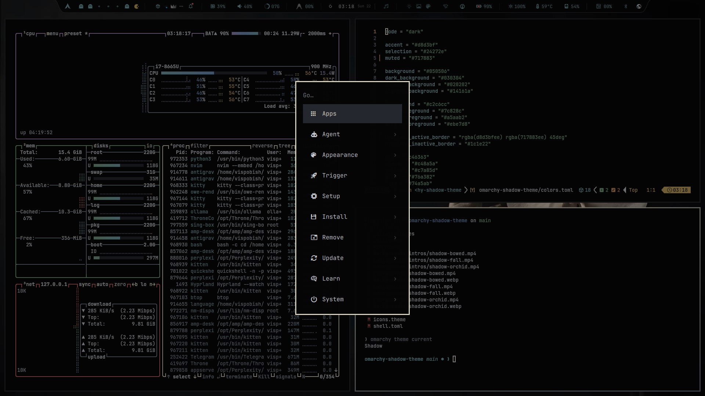
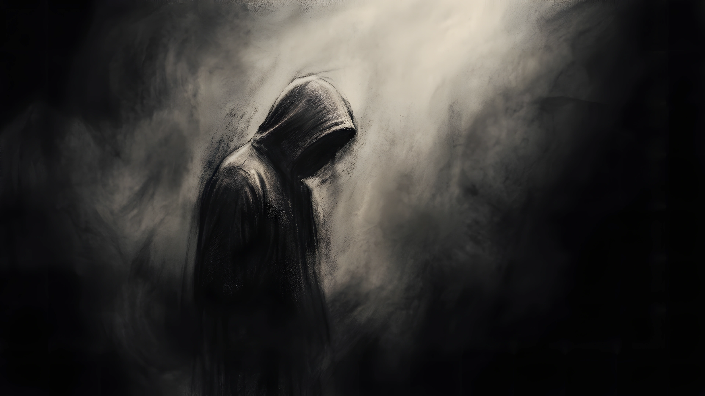
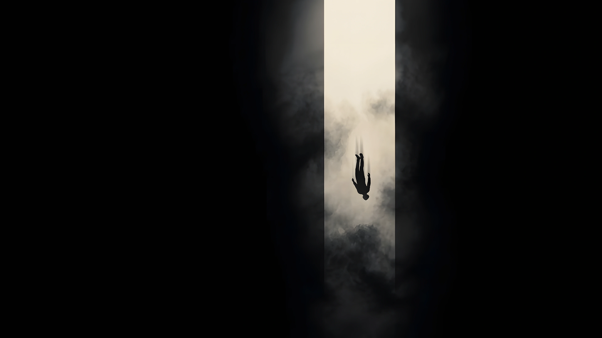
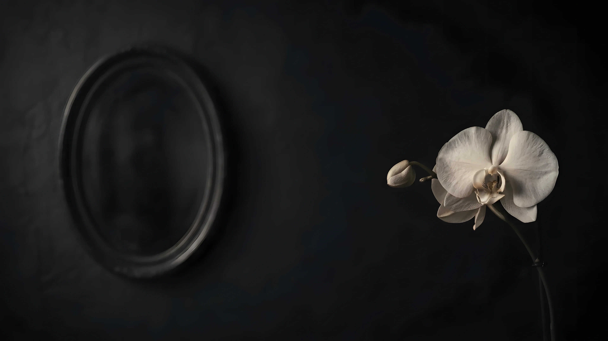

# Shadow

> A near-monochrome, ultra-dark, muted-sage theme for Omarchy.



Shadow delivers a deep, distraction-free environment built around pitch-black `#050506` surfaces paired with calm, muted-sage accents (`#d8d3bf`), subtle borders, and balanced typography. Designed for prolonged focus and visual calm, every color in the palette is tuned for high contrast and legibility (exceeding WCAG AA contrast standards across body and UI chrome).

---

## Color Palette

| Token | Hex | Preview | Contrast on `#050506` | Description |
| :--- | :--- | :---: | :---: | :--- |
| `background` | `#050506` |  | — | Base desktop and window background |
| `dark_background` | `#030304` |  | — | Unfocused surfaces & deep containers |
| `darker_background` | `#020202` |  | — | Scrims and backdrop overlays |
| `lighter_background` | `#14161a` |  | — | Elevated cards and hover fills |
| `foreground` | `#c2c6cc` |  | **11.9:1** | Primary body text |
| `dark_foreground` | `#7c828c` |  | **5.3:1** | Secondary text and metadata |
| `light_foreground` | `#a5aab2` |  | **8.7:1** | Subtle headers and active labels |
| `bright_foreground` | `#ebe7d8` |  | **16.5:1** | Primary titles and bright highlights |
| `accent` | `#d8d3bf` |  | **13.6:1** | Muted sage focus and active indicator |
| `selection` | `#24272e` |  | — | Selection highlight surface |
| `muted` | `#717883` |  | **4.6:1** | Inactive borders & muted elements |

### Accent & Syntax Colors

| Color | Normal | Bright | Normal Hex | Bright Hex |
| :--- | :---: | :---: | :--- | :--- |
| **Red** |  |  | `#c46363` | `#db8080` |
| **Orange** |  |  | `#c48a5a` | `#dda573` |
| **Yellow** |  |  | `#c7a85d` | `#dec178` |
| **Green** |  |  | `#76a382` | `#93bf9e` |
| **Cyan** |  |  | `#74a5ab` | `#91c2c8` |
| **Blue** |  |  | `#6e92bd` | `#8eb0d9` |
| **Magenta** |  |  | `#a28ab5` | `#bda6cf` |
| **Brown** |  |  | `#856a47` | `#af8b5d` |

---

## Wallpapers

Shadow includes three high-resolution 4K wallpapers and live video loops:

| `shadow-bowed` | `shadow-fall` | `shadow-orchid` |
| :---: | :---: | :---: |
| [](backgrounds/shadow-bowed.webp) | [](backgrounds/shadow-fall.webp) | [](backgrounds/shadow-orchid.webp) |

Each wallpaper is accompanied by seamless ambient looping animations in `backgrounds/` and boot intro transitions in `backgrounds/intros/`.

---

## Installation

### Official Registry

Once listed in the official [Omarchy Theme Registry](https://themes.omarchy.org):

```bash
omarchy theme install shadow
```

### Direct from GitHub

You can install directly from this repository at any time:

```bash
omarchy theme install https://github.com/vispobish01-netizen/omarchy-shadow-theme
```

To apply the theme:

```bash
omarchy theme set shadow
```

---

## Credits & License

- **Theme Design:** vispobish & contributors
- **Icon Suite:** Pairs natively with [Yaru](https://github.com/ubuntu/yaru) (`Yaru-sage`)
- **License:** [MIT License](LICENSE)
