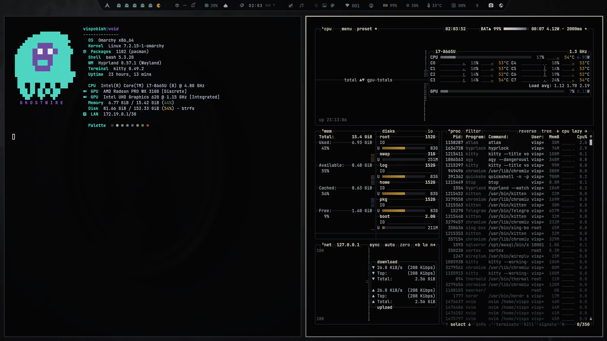

# Shadow

# Installation Theme

To install this theme, simply use the omarchy-theme-install command:

```bash
omarchy-theme-install https://github.com/vispobish01-netizen/omarchy-shadow-theme.git
```


